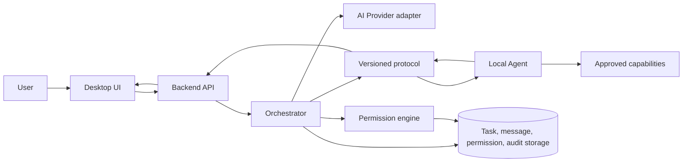

# Phase 1 — System design v0

Status: **rancangan awal**, mengikuti [PRD](https://app.notion.com/p/3ed499df915c813aa30ed73253e837cc), [thesis](https://app.notion.com/p/3eb499df915c8074a7c0fda4a170e142), dan [roadmap](https://app.notion.com/p/3eb499df915c81d5b31fd0f25bb770af). Visi lintas profesi mengikuti [Phase 0](../product/phase-0-foundation.md). Definisi ini tidak berarti layanan sudah diimplementasikan.

## Batas sistem

Jarvis menerima permintaan kerja, belajar, atau aktivitas lain dan menampilkan preview, approval, progres, serta audit. Backend menyimpan identitas, task, pesan, izin, dan log. Orchestrator merencanakan serta mengoordinasikan task. Local Agent menjalankan capability di perangkat tertentu dan **wajib** memverifikasi scope serta izin tepat sebelum eksekusi. Provider AI hanya memberi usulan atau ringkasan; outputnya tidak menjadi authority untuk eksekusi.

Mobile uses the same API and protocol for status and approval, with distinct device identity. Its place in the first release is still an open product decision.

## Domain model

All IDs are opaque UUIDs. Every user-owned aggregate has `user_id`; device actions also carry `device_id`. Persist timestamps in UTC. `created_at` and `updated_at` are recorded by the server. Strings from user, repository, tool output, and model are untrusted input.

| Aggregate | Main fields | Invariant and relationship |
| --- | --- | --- |
| User | id, account status, preferences | Owns Agents, Groups, Projects, Devices, Conversations, Tasks, and permission grants. Account identity comes from authenticated session. |
| Assistant | id, user_id, name, instruction profile, provider preference | User-facing identity; can be assigned one or more Agent roles. Assistant configuration cannot grant tools. |
| Agent | id, assistant_id, role, capability references, status | Role is configuration; actual actions need task-scoped permission. Status: idle, planning, waiting, running, failed, completed. |
| Group | id, user_id, member agent IDs, policy | Optional coordination container. One group owns a conversation; members cannot read projects outside user-approved scope. First-release priority remains open. |
| Conversation | id, user_id, optional group_id/project_id | Contains ordered Messages. Conversation context is explicit, not blanket device access. |
| Message | id, conversation_id, sender type/id, target agent ID, content parts, reply_to, created_at | Immutable event body after creation; edits produce a revision. Mentions route only to agents in the same group. Tool outputs have separate provenance. |
| Project | id, user_id, goal, allowed resources/device IDs | Project can be a work, study, or personal context. A repository root is one optional resource; file paths must remain within explicitly selected scope. |
| Task | id, user_id, project_id, requested_by, assigned_agent_id, state, steps, result | State: proposed → awaiting_approval → queued → running → succeeded/failed/cancelled. Terminal states are immutable; retries create an attempt. |
| Workflow | id, task_id, ordered step IDs, dependencies | Each step has capability, input, scope, risk, state, output reference. The first concrete workflow remains open in Phase 0; the same model applies across domains. |
| Device | id, user_id, public identity, platform, capabilities, last_seen, revoked_at | Pairing establishes identity. Offline means no execution. Revocation blocks future commands. Device-specific capabilities are not inherited from account. |
| Tool | id, version, input/output schema, capability, risk baseline | Registry entry is code-controlled. Model cannot invent a new tool or lower its risk. |
| Permission | id, user_id, device_id, capability, resource scope, duration, decision, expiry | Deny by default. Session or persistent grants never override a mandatory confirmation for sensitive actions. |
| Memory | id, user_id, assistant_id, source, text, consent, retention | Separate from Message history; isolation by assistant and user control. Automatic saving and first-release scope remain open. |

## Permission and risk model

| Level | Example | Gate |
| --- | --- | --- |
| 0 Read | Read a selected document or Git diff | Explicit resource connection and device scope; log access. |
| 1 Reversible | Create task draft | User grant or current-session approval. |
| 2 Modify local data | Edit a file or apply a Git pull | Preview exact resource and ask before operation. |
| 3 External effect | Push, send message, publish | Separate explicit confirmation for each request. Push is out of MVP. |
| 4 Sensitive/destructive | Delete, shutdown, admin command | Separate explicit confirmation; unavailable in MVP. |

The effective risk is the maximum of tool baseline, requested operation, and target resource policy. A permission decision binds `user_id`, `device_id`, `task_id`, `capability`, `resource`, and a short expiry. The Local Agent checks the current grant and task state again before execution. Approvals are single-use for a command, preventing replay. Cancellation should stop queued steps and ask the local runner to terminate work where possible. Every decision and action writes an audit event with redacted inputs.

## Messages, groups, and handoff

The backend verifies conversation membership before reading or posting. A `@mention` resolves to one known group member; ambiguous or external targets are rejected. Agent-to-agent messages carry source agent, destination agent, originating task, and hop count. An agent cannot authorize another agent's tool call. Task handoff transfers an explicit subset of project context, never credentials or blanket conversation history.

## Task workflow

1. User describes a goal and selects the information or app Jarvis may use.
2. Orchestrator creates a plan with named capabilities, context scope, and expected result.
3. User sees the plan and approves actions according to risk and permission settings.
4. Each tool or device verifies scope and authorization before execution.
5. Tool emits progress and result; orchestration handles failures and may request another decision.
6. Jarvis explains the result with links to source context where possible; backend records activity. A developer Git review is one example, not the default for every user.

Commands use idempotency keys. Repeated delivery returns the prior outcome, not a second shell run. Timeout or disconnect leaves a task in an explicit uncertain state until reconciled; it is never silently marked successful.

## Memory

Message history is short-term conversation context. Long-term Memory is a separate, user-visible store keyed by assistant and user, with opt-in, source reference, delete, and retention policy. No tool output is automatically promoted to memory. Memory retrieval must respect project and conversation boundaries. Automatic memory is deferred.

## Decisions still requiring evidence

- Authentication, persistence, transport, and deployment technology are not chosen by this domain design.
- Which workflow, integrations, and surfaces belong in the first release still needs product validation.
- Multi-agent group semantics need real workflow validation before implementation.
- Cross-device approval needs threat modeling and user testing before mobile implementation.

Major choices: [ADR-001](../decisions/ADR-001-local-execution-boundary.md), [ADR-002](../decisions/ADR-002-versioned-contracts.md), [ADR-003](../decisions/ADR-003-approval-authority.md).
